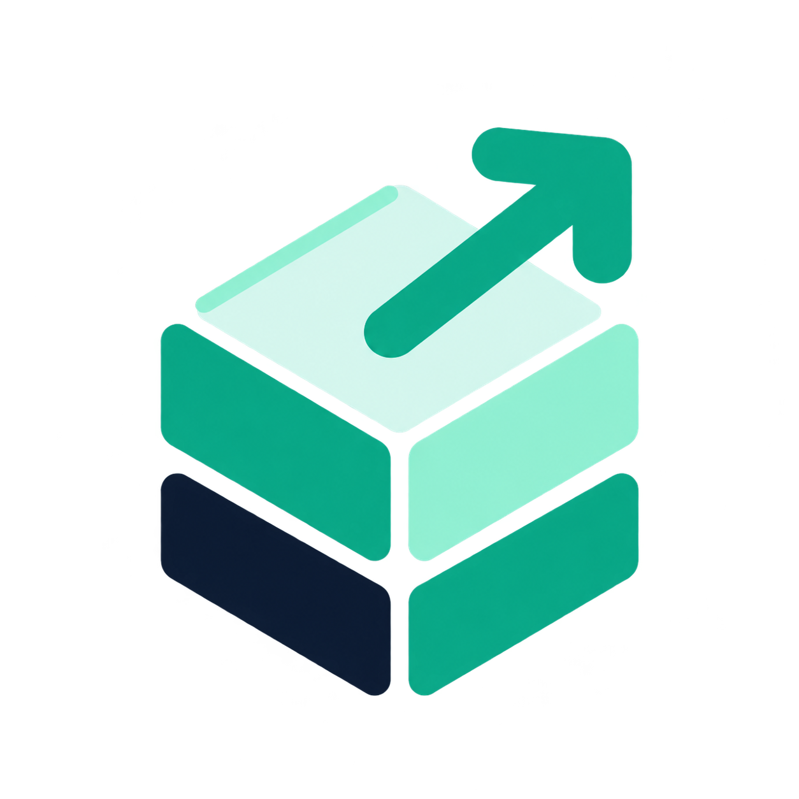

<h1 align="center">ReleaseYard</h1>

<h3 align="center">
  <a name="readme-top"></a>
  
</h3>

<div align="center">

<p align="center">
  A Kubernetes-native internal developer platform that turns a curated Helm catalog into self-service application delivery across clusters, with a real-time dashboard and optional cloud provisioning.
</p>

<div align="center">
  
  
  
  
</div>
</div>

## Table of Contents

- [What is ReleaseYard?](#what-is-releaseyard)
- [How it works](#how-it-works)
- [Dashboard](#dashboard)
- [Application delivery](#application-delivery)
- [Optional cloud resources](#optional-cloud-resources)
- [Quickstart](#quickstart)
  - [Local Kind demo](#local-kind-demo)
  - [Helm chart](#helm-chart)
  - [YAML bundle](#yaml-bundle)
- [Configuration](#configuration)
- [Authentication & authorization](#authentication--authorization)
- [Observability](#observability)
- [Documentation](#documentation)
- [Development](#development)
- [Contributing](#contributing)
- [Disclaimer](#disclaimer)
- [License](#license)

## What is ReleaseYard?

**ReleaseYard** is a Kubernetes operator and web dashboard for platform teams. It
turns a curated Helm catalog into self-service application delivery across one
or more Kubernetes clusters. A platform team registers clusters and publishes
reusable templates; a team picks a template and creates an `Application`. The
operator installs, updates, and removes the matching Helm release on the
selected cluster.

It is built around a small set of ideas:

- **Kubernetes-native API**: everything is a CRD on the management cluster. No
  proprietary state store, and the platform is GitOps-friendly.
- **Curated catalog**: an `ApplicationDefinition` pins a chart, its defaults,
  and the only values an `Application` may override.
- **Multi-cluster delivery**: target one `Cluster` or follow every cluster
  matching an environment.
- **Safe installs**: chart bytes are verified by SHA-256 before Helm sees them,
  and the manager only downloads from allowed chart hosts.
- **Real-time dashboard**: browse the catalog, create Applications, inspect live
  workloads, logs, CPU/memory, and activity.
- **Kubernetes RBAC**: users sign in with OIDC (or the local administrator) and
  the management cluster decides what they may do.
- **Team isolation**: teams live in `releaseyard-team-<group>` namespaces.
- **Optional cloud provisioning**: `CloudTarget`, `ResourceDefinition`, and
  `Resource` can create cloud objects through Crossplane. Crossplane is never
  bundled with ReleaseYard.

## How it works

```text
 ApplicationDefinition ──┐
 Cluster ────────────────┼──► ReleaseYard operator ──► managed clusters (Helm)
 Application ────────────┘

 CloudTarget ────────────┐
 ResourceDefinition ─────┼──► ReleaseYard operator ──► Crossplane managed resources
 Resource ───────────────┘
```

The operator runs on a **management cluster** and reconciles six custom
resources:

| Kind | Scope | Purpose |
|------|-------|---------|
| `Cluster` | Cluster | A target workload cluster, reached through a kubeconfig Secret. |
| `ApplicationDefinition` | Cluster | A pinned Helm chart plus defaults and the typed value surface. |
| `Application` | Namespaced | A request to deploy that chart on one cluster or an environment. |
| `CloudTarget` | Cluster | Where cloud resources should be created: provider, region, credentials. |
| `ResourceDefinition` | Cluster | A golden path for a cloud resource: templates, mappings, and outputs. |
| `Resource` | Namespaced | A team request for a cloud resource, rendered into Crossplane objects. |

For each `Application`, the operator resolves the definition and target, fetches
and verifies the chart, and installs a Helm release named after the team and the
Application. It keeps the release in sync on updates and uninstalls it when the
`Application` is deleted.

Read more in [Architecture](docs/architecture.md).

## Dashboard

The dashboard is the front door for platform admins and teams:

- **Catalog**: browse validated `ApplicationDefinition`s and create Applications.
- **Applications**: manage Applications owned by the signed-in user.
- **Clusters**: see registered target clusters, connectivity, and nodes.
- **Cloud**: when Crossplane is installed, browse cloud targets and resource
  definitions, and create or delete `Resource` requests.
- **Application detail**: Overview, Resources, Configuration, Observability, and
  Activity tabs, including live resource YAML, Pod logs, and CPU/memory.
- **Administration**: Identity provider, Access definitions, Cluster access, and
  Access applications. The panel materializes Kubernetes RBAC; it does not keep
  a separate permission model.

A fresh installation starts with **local administrator authentication only**.
OIDC can be configured later from the Administration page, without a restart.

See the [Dashboard documentation](docs/dashboard.md).

## Application delivery

An `Application` can target one cluster or an environment:

- **One cluster**: set `spec.clusterRef`. The Application produces one Helm
  release on that cluster.
- **All clusters in an environment**: set `spec.environment.name`. The
  controller resolves the matching `Cluster`s dynamically and produces one
  release per target. A new matching Cluster is added automatically; a Cluster
  that leaves the environment is removed. Supply `spec.environment.targets` only
  when you want to pin a fixed target set.

The release namespace can be selected with `spec.releaseNamespace` when the
definition allows it; otherwise the definition's `spec.release.namespace` is
used. Release names combine the team namespace token and the Application name,
so different teams can use the same Application name safely.

See [Applications](docs/applications.md) for the full contract and lifecycle.

## Optional cloud resources

ReleaseYard can expose cloud resources through the same self-service model. The
integration is intentionally **optional** and **separate**: the platform team
installs and operates Crossplane, while ReleaseYard only creates managed
resources through the Kubernetes API.

> [!IMPORTANT]
> The ReleaseYard Helm chart never installs Crossplane. Do not add it as a
> subchart or expect the ReleaseYard install to provide it.

The model has three pieces:

- **`CloudTarget`** — *where* to create resources: provider, region, and a
  reference to a namespaced Crossplane `ProviderConfig` with credentials and
  endpoint.
- **`ResourceDefinition`** — *what* to create: managed-resource templates, a
  static `base`, mappings from `values.*` / `target.*`, and outputs read from
  status.
- **`Resource`** — the team request: definition, target, and allowed values.

The local demo in [`examples/cloud-bucket/`](examples/cloud-bucket/) shows the
full sequence for an S3 bucket. The real-AWS EC2 example is in
[`examples/aws-ec2/`](examples/aws-ec2/).

See [Cloud resources](docs/cloud-resources.md) for prerequisites, credentials,
and the Crossplane contract.

## Quickstart

Requirements: Docker, `kubectl`, Kind, Go, Helm, and Python 3.

### Local Kind demo

Create the management cluster (`releaseyard-a`), two workload clusters
(`releaseyard-managed-a/b`), install ChartMuseum, and publish the demo chart:

```bash
bash hack/setup-kind-workloads.sh
```

Build and load the controller and dashboard images:

```bash
docker build -t releaseyard-controller:dev .
docker build -f Dockerfile.dashboard -t releaseyard-dashboard:dev .
kind load docker-image releaseyard-controller:dev --name releaseyard-a
kind load docker-image releaseyard-dashboard:dev --name releaseyard-a
```

Install the controller with the chart:

```bash
helm upgrade --install idp dist/chart \
  -n idp-system --create-namespace \
  --set manager.image.repository=releaseyard-controller \
  --set manager.image.tag=dev \
  --set manager.allowedChartHosts=chartmuseum.chartmuseum.svc.cluster.local:8080
```

Deploy the dashboard with the local kustomization:

```bash
kubectl --context kind-releaseyard-a apply -k config/dashboard
```

Register the workload kubeconfigs with the management cluster:

```bash
kubectl --context kind-releaseyard-a -n idp-system create secret generic releaseyard-managed-a-kubeconfig \
  --from-file=kubeconfig=.local/kubeconfigs/releaseyard-managed-a.kubeconfig
kubectl --context kind-releaseyard-a -n idp-system create secret generic releaseyard-managed-b-kubeconfig \
  --from-file=kubeconfig=.local/kubeconfigs/releaseyard-managed-b.kubeconfig
```

Apply the samples:

```bash
kubectl --context kind-releaseyard-a apply -f config/samples/platform_v1alpha1_cluster.yaml
kubectl --context kind-releaseyard-a apply -f config/samples/platform_v1alpha1_applicationdefinition.yaml
kubectl --context kind-releaseyard-a apply -f config/samples/platform_v1alpha1_application.yaml
```

Open the dashboard at `http://127.0.0.1:8080`:

```bash
kubectl --context kind-releaseyard-a -n idp-system port-forward service/releaseyard-dashboard 8080:8080
```

Read the generated local administrator password and sign in as `admin`:

```bash
kubectl --context kind-releaseyard-a -n idp-system get secret releaseyard-dashboard-local-admin \
  -o jsonpath='{.data.initial-password}' | base64 -d
```

To try the optional cloud flow, install Crossplane on `releaseyard-a`, run
`bash hack/setup-crossplane-localstack.sh`, then apply
`examples/cloud-bucket/03-cloudtarget.yaml` through `05-resource.yaml`. The
setup script installs LocalStack, the S3 provider, the credentials Secret, and
the `ProviderConfig`.

See [Getting started](docs/getting-started.md) for the same flow with more
detail and cleanup commands.

### Helm chart

The chart lives in [`dist/chart`](dist/chart). A minimal install is:

```bash
helm upgrade --install idp dist/chart -n idp-system --create-namespace \
  --set manager.image.repository=<registry>/releaseyard-controller \
  --set manager.image.tag=<tag>
```

Enable the dashboard with `dashboard.enabled=true` and set
`dashboard.image.repository`, `dashboard.image.tag`, and `dashboard.publicURL`.
With the default chart naming the dashboard Service is `<release>-dashboard`
(for example `idp-dashboard`) and the local administrator Secret is
`<release>-dashboard-local-admin`.

See [Configuration](docs/configuration.md) for the important values.

### YAML bundle

Generate a single controller manifest and apply it:

```bash
make build-installer IMG=<registry>/releaseyard-controller:<tag>
kubectl apply -f dist/install.yaml
```

The bundle contains the CRDs and the controller, not the optional dashboard.

## Configuration

The main configuration surfaces are:

- **`ApplicationDefinition`** — chart repository, name, pinned version, release
  namespace, defaults, and `configurableValues`.
- **`Application`** — definition reference, one placement (`clusterRef` or
  `environment`), optional `releaseNamespace`, and values.
- **`CloudTarget` / `ResourceDefinition` / `Resource`** — the optional cloud
  contract.
- **Helm values** — manager image, allowed chart hosts, RBAC helpers, dashboard
  image/public URL, metrics, and optional Ingress.

Examples are in [`config/samples/`](config/samples/). Full details are in
[Configuration](docs/configuration.md).

## Authentication & authorization

- **Local administrator** — the chart bootstraps a Secret with a bcrypt hash and
  a generated initial password. Sign in as `admin` and change the dashboard
  configuration. The password is never stored in Helm values or printed in logs.
- **OIDC** — configure issuer URL, client ID, and client secret from the
  Administration page. The dashboard stores them in a Secret and applies them
  immediately, without a restart.
- **Authorization** — the dashboard impersonates the signed-in user, so the
  management cluster's Kubernetes RBAC is the source of truth. Any user may read
  the catalog; writes require the corresponding RBAC permission.
- **Administration** — available to the local administrator and to OIDC groups
  listed in `dashboard.adminGroups` (requires `rbac.helpers.enabled=true`).
- **Helper roles** — the chart can install admin/editor/viewer roles for
  Applications, Application Definitions, and Clusters when
  `rbac.helpers.enabled=true`.

See [Access control](docs/access-control.md) for the full model.

## Observability

The Application detail page reads live data from the target cluster:

- resource YAML with status (Secrets excluded);
- Pod logs;
- per-Pod CPU and memory from `metrics.k8s.io`;
- Kubernetes events and recent deployment activity.

CPU/memory requires `metrics-server` on the managed cluster. When it is absent,
the dashboard reports that instead of failing. `hack/setup-managed-metrics.sh`
installs it on the Kind workload clusters.

The controller manager exposes Prometheus metrics on its secure endpoint when
`metrics.enabled=true`. See [Observability](docs/observability.md).

## Documentation

| Topic | Description |
|-------|-------------|
| [Getting started](docs/getting-started.md) | Local Kind demo, Helm install, dashboard access, cleanup |
| [Architecture](docs/architecture.md) | Control plane, CRDs, reconciliation, safety model |
| [Dashboard](docs/dashboard.md) | Pages, detail tabs, and administration |
| [Applications](docs/applications.md) | Catalog contract, placement, values, release lifecycle |
| [Cloud resources](docs/cloud-resources.md) | Crossplane integration, targets, definitions, examples |
| [Access control](docs/access-control.md) | Local admin, OIDC, impersonation, team namespaces, RBAC |
| [Hardening](docs/hardening.md) | Security and reliability backlog, priorities, acceptance criteria |
| [Observability](docs/observability.md) | Live resources, logs, metrics, events, Prometheus |
| [Configuration](docs/configuration.md) | CRD fields and Helm values |
| [Development](docs/development.md) | Build, test, lint, e2e, local workflows |
| [Troubleshooting](docs/troubleshooting.md) | Common failures and fixes |

## Development

```bash
make help          # list targets
make manifests     # regenerate CRDs and RBAC
make generate      # regenerate DeepCopy code
make test          # unit and envtest suites
make lint          # golangci-lint
make test-e2e      # isolated Kind end-to-end suite
```

The end-to-end suite creates its own Kind cluster, deploys the manager, and
checks the manager, the metrics endpoint, and the `Resource` controller. The
chart has a separate workflow that lints and installs the chart to catch
distribution drift.

See [Development](docs/development.md) for local image rebuilds and test details.

## Contributing

Contributions are welcome. Please:

1. Fork the repository.
2. Create a feature branch.
3. Make your changes and add tests where it matters.
4. Run `make lint` and `make test`.
5. Submit a pull request explaining the change.

## Disclaimer

> [!CAUTION]
> ReleaseYard installs Helm releases into the clusters you register and can
> create cloud resources through Crossplane. Grant access deliberately, review
> the RBAC it uses, and test in an isolated environment first. The LocalStack
> helper and fake credentials are for development only; never use them in
> production.

## License

Copyright 2026. Licensed under the [Apache License, Version 2.0](https://www.apache.org/licenses/LICENSE-2.0).
